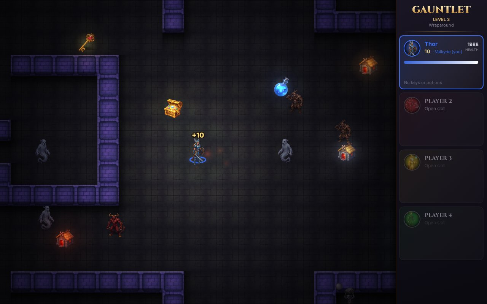

# Gauntlet

A web remake of Atari's 1985 coin-op **Gauntlet**. Up to four players work together online, each in their own browser.

**Play it at https://gauntlet.dataplug-oy.com/**



## Features

- Online co-op for up to 4 heroes (Warrior, Valkyrie, Wizard, Elf), with a lobby and waiting rooms. Players can join a game in progress at the start of a level.
- Monster generators, keys and doors, food, treasure and potions, and levels that wrap around the edges.
- Gauntlet II additions: stun tiles, traps, breakable walls, transporters and force fields; dragons, thieves, acid puddles and super sorcerers; amulets (invisibility, invulnerability, repulsiveness, reflective shots, super shots, transportability), poison and the It ball.
- Built-in levels, plus optional imports of the original Gauntlet and Gauntlet II arcade maps.
- A level editor in the browser: draw your own levels, test them right away and play them with friends.

## Controls

Arrow keys to move, **Z** to fire, **X** to use a potion, **Esc** for the menu. Gamepads also work.

## Running it yourself

```bash
npm install
npm run dev                     # development server with the game server attached
npm run build && npm start      # production server on PORT (default 8080)
```

Saved players and custom levels are stored in `~/.gauntlet/` (set `DATA_DIR` to change it). Run `npm run import:g1` and `npm run import:g2` to download and convert the Gauntlet and Gauntlet II arcade maps. The maps aren't included in this repository because the layouts are Atari's. The Gauntlet II importer reads the maps from screenshots, so it skips the ones it can't read reliably (72 of 103 come through).

### Docker

```bash
docker build -t gauntlet .
docker run -p 8080:8080 -v ~/.gauntlet:/data gauntlet
```

To add the arcade maps to a running container, run `docker exec <container> npx tsx tools/import-vgmaps.ts` (and `tools/import-g2.ts` for Gauntlet II), then restart it.

Developer notes (architecture, level format, graphics pipeline) are in [CLAUDE.md](CLAUDE.md).
